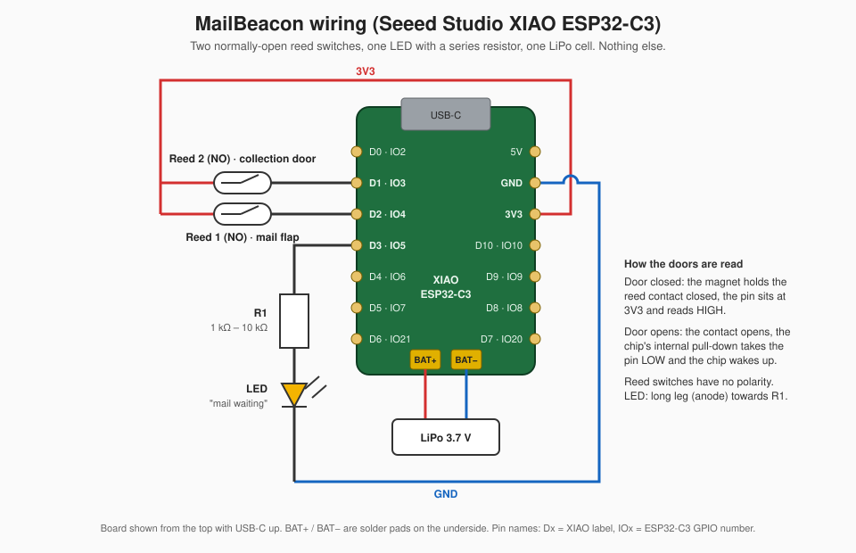

# MailBeacon

**A battery-powered, wire-free mailbox sensor for Home Assistant.**
Built on the Seeed Studio XIAO ESP32-C3, it tells you the moment mail arrives and when it has been collected, over Bluetooth Low Energy using the open [BTHome](https://bthome.io) format. No Wi-Fi, no MQTT broker, no pairing, no cloud. Home Assistant discovers it automatically.

`home-assistant` `bthome` `esp32-c3` `xiao-esp32c3` `esp-idf` `nimble` `ble` `mailbox` `letterbox` `mail-sensor` `deep-sleep` `battery-powered` `reed-switch`

---

## What it does

1. The mail carrier opens the flap. The sensor wakes from deep sleep, remembers **"mail waiting"**, broadcasts the new state for a few seconds, lights an LED on the mailbox, and goes back to sleep.
2. Home Assistant picks up the broadcast through its own Bluetooth adapter or any ESPHome / Shelly Bluetooth proxy in range and flips a binary sensor to **on**. Your automations take it from there: a phone notification, a light, a voice announcement.
3. You open the collection door. The sensor wakes, remembers **"mailbox empty"**, broadcasts, turns the LED off, and sleeps again.
4. Once a day it wakes on its own to re-broadcast the current state as a heartbeat.

Between those moments the device is in deep sleep and draws tens of microamps. A small LiPo cell lasts many months.

## Why BTHome and Home Assistant

- **Long range for almost nothing.** BLE advertisements at +9 dBm carry comfortably **from a mailbox at lobby to a Bluetooth proxy in the flat two stories up through thick concrete**. Every ESPHome device with `bluetooth_proxy:` enabled, and many Shelly devices, relay BTHome packets to Home Assistant, so coverage grows with presumably existing hardware at minimal cost.
- **Zero configuration.** Home Assistant's built-in BTHome integration recognises the device and creates the entity on its own. There is nothing to enter.
- **Nothing to keep alive.** No Wi-Fi association, no DHCP, no TLS handshake, no broker connection. Waking, sending and sleeping takes a few seconds, which is what makes the battery life possible.
- **Open and local.** BTHome is an open specification. The data never leaves your home.

## Hardware

| Part | Notes |
|---|---|
| Seeed Studio XIAO ESP32-C3 | Any ESP32-C3 board works with pin changes, but this one has a battery charger, an external antenna connector and the right pins exposed. |
| 2 × reed switch, **normally open** (Form A), with magnets | One for the mail flap, one for the collection door. |
| 1 × LED + series resistor | Visible "mail waiting" indicator on the box. 1 kΩ to 10 kΩ, see [Battery life](#battery-life). |
| 1 × LiPo cell, 3.7 V | 500 to 2000 mAh with a JST connector or soldered to the BAT pads. The XIAO charges it over USB-C. |
| External 2.4 GHz antenna | Comes with the XIAO. Mount it outside any metal enclosure. If possible. I have mine inside and it works. |

### Wiring



| XIAO pin | GPIO | Connects to | Role |
|---|---|---|---|
| D2 | GPIO4 | Reed switch 1, other side to **3V3** | Mail flap (`SMALL_DOOR_GPIO`) |
| D1 | GPIO3 | Reed switch 2, other side to **3V3** | Collection door (`BIG_DOOR_GPIO`) |
| D3 | GPIO5 | Resistor, then LED anode; LED cathode to **GND** | "Mail waiting" LED (`MAIL_LED_GPIO`) |
| BAT+ / BAT− | | LiPo cell | Power |

The reed switches use the chip's internal pull-downs, so no external resistors are needed. Mount each magnet so that it sits **next to the reed switch while the door is closed**. Closed door means the contact is closed and the pin reads high. Opening the door breaks the contact, the pull-down takes the pin low, and that falling level is what wakes the chip.

Only GPIO0 to GPIO5 can wake an ESP32-C3 from deep sleep. If you move the switches, stay inside that range.

## Firmware

MailBeacon is plain C on ESP-IDF with the NimBLE stack, built with PlatformIO. It is not ESPHome or Arduino. That keeps the binary small and the wake-to-sleep cycle short, which is where the battery life comes from.

### Build and flash

1. Install [PlatformIO](https://platformio.org) (VS Code extension or CLI).
2. Clone this repository.
3. Create your credentials file for the maintenance Wi-Fi network:

   ```sh
   cp src/secrets.h.example src/secrets.h
   ```

   Edit `src/secrets.h` and set your own `OTA_AP_SSID` and `OTA_AP_PASSWORD`. The file is git-ignored. The build fails on purpose if the password is missing or shorter than 8 characters. You can also pass both as `-D` build flags in `platformio.ini` instead.

4. Connect the XIAO over USB-C and run:

   ```sh
   pio run -t upload
   pio device monitor
   ```

   The monitor shows the wake reason, the state and the BLE broadcast on each cycle.

`platformio.ini` pins the platform to `espressif32 @ 6.13.0`, which ships ESP-IDF 5.5.3, matching the checked-in `sdkconfig.seeed_xiao_esp32c3`. The code also builds on ESP-IDF 6.x if you raise the pin. After any toolchain upgrade, check that `CONFIG_ESP_SLEEP_GPIO_ENABLE_INTERNAL_RESISTORS` is still **off** in the regenerated sdkconfig. With it on, the SDK swaps the wake pins to pull-up right before sleeping and the doors stop waking the device.

### Home Assistant setup

1. Make sure Home Assistant can hear Bluetooth: either a Bluetooth adapter on the HA host, or at least one ESPHome device with `bluetooth_proxy:` (with `active: false` is enough), or a Shelly Gen2+ device with Bluetooth gateway enabled.
2. Power the sensor and open and close the mail flap once.
3. Within a minute Home Assistant shows **"New devices discovered"** under Settings → Devices & services, listed as a BTHome device named **Mailbox**. Click Add.
4. You get one entity, a binary sensor of class *occupancy*. Rename it to taste, for example `binary_sensor.mailbox_mail_waiting`. **On** means mail is waiting, **off** means the box is empty.

Example automation:

```yaml
alias: Mail has arrived
triggers:
  - trigger: state
    entity_id: binary_sensor.mailbox_mail_waiting
    to: "on"
actions:
  - action: notify.mobile_app_your_phone
    data:
      title: "Mailbox"
      message: "You've got mail."
```

The device is flagged to Home Assistant as *trigger based*, so HA does not mark it unavailable between broadcasts even though it is silent for hours at a time.

### Maintenance mode and over-the-air updates

You never need to take the sensor off the mailbox to update it.

1. Hold **both** doors open at the same time for about 6 seconds. The LED starts blinking once per second.
2. The sensor starts a Wi-Fi access point with the SSID and password from your `secrets.h`.
3. Connect a phone or laptop to it and open **http://192.168.4.1**.
4. Pick the new `firmware.bin` (found in `.pio/build/seeed_xiao_esp32c3/`) and press *Upload & Reboot*. The device flashes the other OTA slot and restarts into the new firmware.
5. If nothing is uploaded for 10 minutes, the access point shuts down and the sensor goes back to sleep on its own.

The access point is WPA2 protected with the password you chose. While it is active, anyone within Wi-Fi range who knows that password can flash arbitrary firmware. Choose a unique password and do not publish your `secrets.h`.

## How it behaves in detail

- **Fast flap handling.** A flap can open and shut in 50 ms, faster than the chip boots. The firmware reads the hardware register that latched which pin caused the wake, so a delivery is registered even if the flap is already closed by the time the code runs.
- **State logic.** The flap only ever sets "mail waiting". The collection door only ever clears it. Opening the flap twice, or opening the collection door when the box is already empty, changes nothing and sends the unchanged state.
- **Stuck-open protection.** Before sleeping, the firmware arms a wake only on doors that are currently closed. A door left open cannot wake the chip in a loop and drain the battery.
- **Daily heartbeat.** A 24 hour timer wakes the chip to re-broadcast the state and re-arm any door that has since been closed.
- **State survives power loss.** The current state lives in RTC memory across deep sleep and is mirrored to flash (NVS) on every change, so a battery swap restores it.
- **Broadcast.** On every wake the device advertises for 5.5 s at 50 to 100 ms intervals at +9 dBm, non-connectable, BTHome v2 unencrypted, with the local name `Mailbox`.
- **LED.** Latched on through deep sleep while mail is waiting, off otherwise, with a short triple blink before each sleep as a sign of life.

## Battery life

Typical standby current, measured at the battery:

| Drain | Approximate |
|---|---|
| ESP32-C3 in deep sleep | 5 µA |
| XIAO board regulator and charger | 40 µA |
| Internal pull-down on each **closed** door | 70 µA per door |
| LED while mail is waiting | set by your resistor, roughly 0.3 mA with 4.7 kΩ, 3 mA with 330 Ω |
| Each wake cycle (boot, 5.5 s broadcast, sleep) | about 0.04 mAh |

With a 1000 mAh cell and a few wakes a day, expect 6 to 8 months with the LED mostly off. Two things change that picture substantially:

- **The LED resistor.** A modern high-efficiency LED is clearly visible at 0.3 mA. Use 4.7 kΩ to 10 kΩ rather than the usual 220 to 330 Ω, otherwise a week of uncollected mail costs more than months of standby.
- **The reed switch sense.** The internal pull-downs only draw current while a door is closed, which is nearly always. Using a normally-closed (Form B) reed switch, or mounting the magnet so the contact is open while the door is closed, removes that 140 µA entirely and roughly triples standby life. This needs a one-line change in the firmware (wake on high instead of low) and is on the roadmap.

## What it can and cannot do

**Can**

- Report "mail waiting" and "mailbox empty" to Home Assistant within seconds, through walls and across a garden, via any Bluetooth proxy.
- Run for months on a small LiPo cell and recharge over USB-C.
- Show the state locally with an LED on the box.
- Be updated over the air from a phone without removing it.
- Survive power loss and battery swaps without forgetting its state.
- Work with Home Assistant out of the box, with no YAML and no add-ons.

**Cannot**

- **Encrypt its broadcasts.** BTHome supports encryption but this firmware sends plain packets. Anyone with a BLE scanner within range can see whether your mailbox has mail in it. If that matters to you, do not use it yet.
- **Report battery level.** The advertisement carries only the mail state. A low-battery sensor is on the roadmap.
- **Be reset or controlled from Home Assistant.** Communication is one-way. The state changes only when a door physically moves.
- **Count letters or detect mail without the flap opening.** It senses doors, not contents. Parcels placed in an open box without touching the flap are not seen.
- **Tell flap-open from flap-closed.** Opening the flap means delivery, nothing more.
- **Work without a Bluetooth receiver in range.** You need a Bluetooth adapter on the Home Assistant host or a Bluetooth proxy within roughly 10 to 30 m, depending on walls and antenna placement.
- **Run on other chips without changes.** Deep-sleep GPIO wake on GPIO0 to GPIO5 is specific to the ESP32-C3. Porting to a C6 or S3 means touching the wake and hold code.
- **Keep time.** There is no clock. "Once a day" means 24 hours after the last wake.

## Project layout

```
src/main.c              Wake logic, BTHome advertising, LED, deep sleep
src/ota_server.c/.h     Maintenance mode: Wi-Fi AP and HTTP firmware upload
src/secrets.h.example   Template for your Wi-Fi credentials (copy to secrets.h)
docs/wiring.svg         Wiring diagram
partitions.csv          NVS + two OTA app slots
sdkconfig.defaults      Project-level ESP-IDF options
platformio.ini          Build configuration (PlatformIO, ESP-IDF framework)
```

## Troubleshooting

- **Home Assistant never discovers it.** Check that a Bluetooth proxy or adapter is in range with a phone BLE scanner app: you should see a device named `Mailbox` for a few seconds after you open the flap. Metal mailboxes shield the signal badly. Mount the antenna outside or at an opening.
- **It wakes constantly or never sleeps.** A door is read as closed while it is open or vice versa. Check the magnet position against the reed switch and the serial monitor's wake messages.
- **The LED goes off in deep sleep.** The LED must be on GPIO0 to GPIO5. Other pins lose their state in deep sleep on the C3.
- **The build complains about `OTA_AP_PASSWORD`.** Create `src/secrets.h` from the example and set a password of 8 to 63 characters.
- **It wakes from the doors on the bench but not after a toolchain upgrade.** Re-check `CONFIG_ESP_SLEEP_GPIO_ENABLE_INTERNAL_RESISTORS` in the regenerated sdkconfig, it must be off.

## Roadmap

- Battery voltage in the BTHome packet (would require additional soldering or different board)
- BTHome encryption
- Normally-closed reed switch mode for zero standby current on the door pins
- Light-sleep during the broadcast window to shorten the wake cycle further

## Contributing

Issues and pull requests are welcome. Please describe your mailbox, switch placement and Home Assistant Bluetooth setup when reporting detection problems; they explain most of them.

## License

[MIT](LICENSE)
